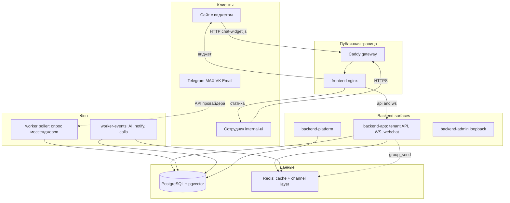
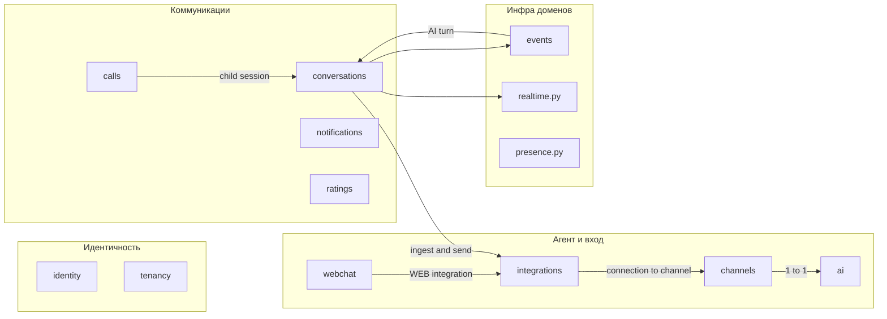
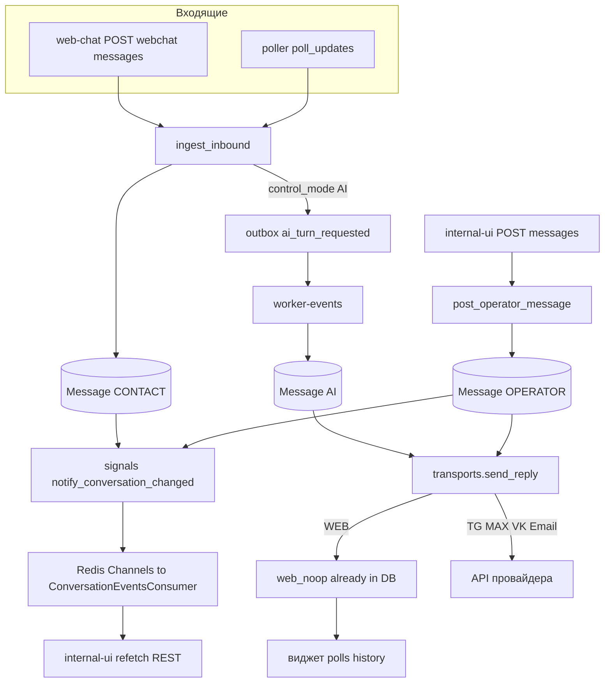
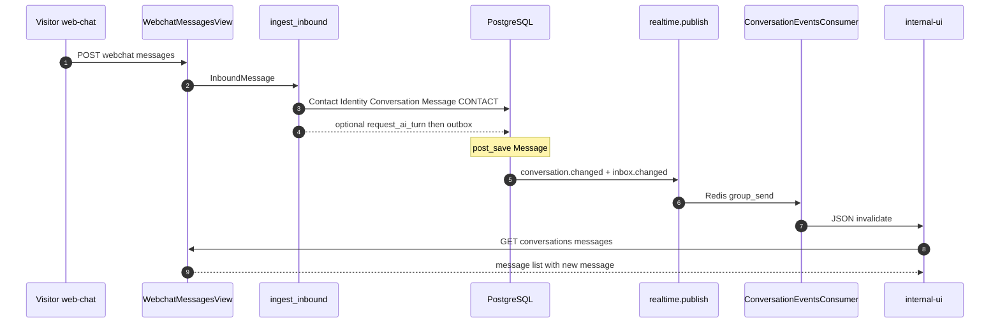
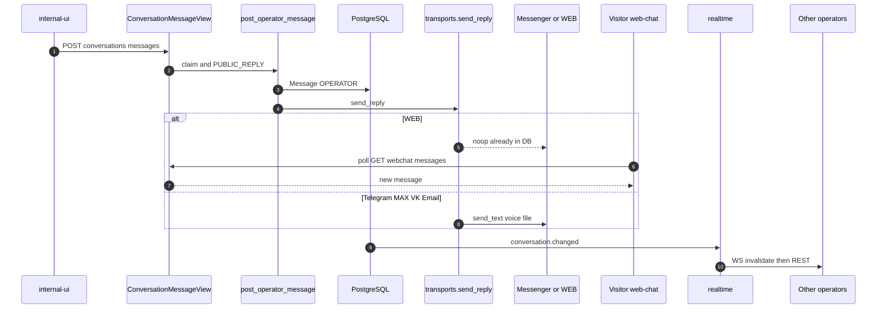
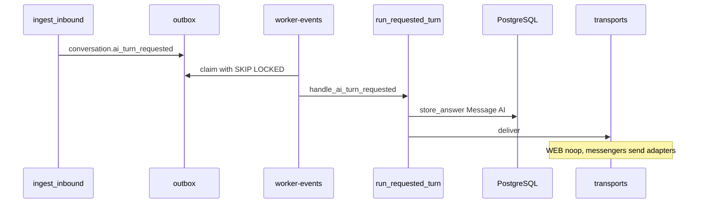
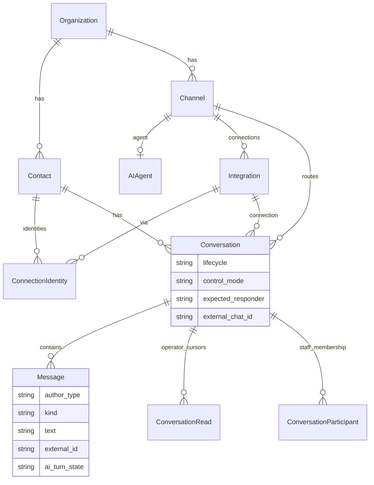

# Архитектура Chatballs

Self-hosted ИИ-платформа клиентской поддержки: модульный Django-монолит, один `compose.yaml`, мультитенантность через PostgreSQL RLS. Клиент пишет в мессенджер или виджет → сообщение попадает в единый `Message` → операторы видят его в `internal-ui`, ответ уходит тем же транспортом (или появляется в виджете по poll).

Канонические источники: [`.skaro/architecture.md`](../.skaro/architecture.md), ADR-0001, ADR-0002, ADR-0008, ADR-0018, ADR-0028.

---

## Ключевые понятия

| Понятие | Что это |
|--------|---------|
| **Organization** | Граница изоляции данных. Всё клиентское принадлежит организации. `organization_id` от клиента никогда не основание доступа. |
| **HumanUser / Membership** | Глобальная учётка + участие в организации (`OWNER` / `ADMIN` / `EMPLOYEE`). Один пользователь — несколько организаций. |
| **Агент** | Продуктовый объект «кто отвечает». В БД это пара `Channel` ↔ `AIAgent` 1:1: канал — якорь группы/подключений, агент — инструкции, модель, знания. В UI «канал» отдельно не показывается. |
| **Интеграция (подключение)** | Транспорт или LLM-провайдер (`Integration`). Мессенджеры: Telegram, MAX, VK, WEB, EMAIL. Не владеют диалогами и знаниями. |
| **Contact** | Клиент организации (имя, телефон, email…). |
| **ConnectionIdentity** | Связка контакта с внешним id в конкретном подключении (`external_user_id`). |
| **Conversation** | Одно обращение/диалог. Три оси состояния (ниже). Новое сообщение после `CLOSED` создаёт **новый** диалог, а не открывает старый. |
| **Lifecycle** | `OPEN` / `CLOSED` / `SPAM` — жив ли диалог как обращение. |
| **ControlMode** | `AI` / `HUMAN` / `PAUSED` — кто ведёт переписку. Новый диалог стартует в `AI`. |
| **ExpectedResponder** | `CUSTOMER` / `AI` / `OPERATOR` / `NOBODY` — от кого ждут следующую реплику. |
| **Message** | Единица ленты. `author_type`: `CONTACT` / `AI` / `OPERATOR` / `SYSTEM`. |
| **ConversationParticipant** | Не «участник чата», а временное членство **сотрудника** в диалоге (специалист join/leave). |
| **ingest_inbound** | Единая точка приёма входящих: виджет и poller мессенджеров. |
| **Inbox / Outbox** | Идемпотентный приём и отложенная доставка событий (`events`). Приём только пишет; ход AI — отдельно на `worker-events`. |
| **Realtime (invalidate-only)** | WebSocket операторам несёт «обновись», не тело сообщения. Данные — повторным REST. |
| **Claim** | Атомарный захват диалога сотрудником в режиме `HUMAN`; писать клиенту может назначенный. |

---

## Карта системы

---

## Модули backend (границы ответственности)

Приложения: `apps/backend`, `apps/internal-ui`, `apps/web-chat`. Пакеты: `packages/contracts`, `packages/shared`, `packages/ui`.

---

## Прохождение сообщения: общая схема

Один персистентный центр — `Message` на `Conversation`. Асимметрия доставки:

| Получатель | Как узнаёт о новом сообщении |
|------------|------------------------------|
| Другие операторы | WS invalidate → REST refetch |
| Посетитель веб-чата | Poll `GET /api/v1/webchat/messages/?since=` |
| Клиент в мессенджере | Синхронный/адаптерный `transports.send_*` |

Webhook’ов мессенджеров нет: входящие с Telegram/MAX/VK/Email — через **poller**.

---

## Sequence: клиент → оператор (веб-чат)

Мессенджер отличается только входом: `poll_all_messengers` → тот же `ingest_inbound`.

---

## Sequence: оператор → клиент

---

## Sequence: AI-ответ (отдельно от приёма)

По ADR-0028 poller/HTTP только записывают; генерация — на `worker-events`.

Пока ход в `PENDING`/`RUNNING`, виджет в poll видит `thinking` (не классический typing оператора).

---

## Доменная модель сообщения (упрощённо)

---

## Важные детали пути

1. **Единый ingest.** И виджет (`webchat.services.post_message`), и poller сходятся в `conversations/ingest.py::ingest_inbound`.
2. **Исходящие оператора.** `operator_messages.post_operator_message` пишет `Message` и сразу зовёт транспорт (с `domain_operation("PUBLIC_REPLY")` и проверкой `require_human_reply`).
3. **Realtime не несёт контент.** `conversations/realtime.py` шлёт только `inbox.changed` / `conversation.changed`; видимость и тело — в REST.
4. **Веб-чат без WS.** Доставка клиенту — БД + poll; для WEB исходящий транспорт — noop.
5. **Нет messenger webhooks.** Входящие с внешних сетей — цикл `worker --role=poller` (~каждые несколько секунд).
6. **Read receipts** — курсор оператора (`ConversationRead`), наружу клиенту не уходят.
7. **Presence** — hint по открытым WS сотрудников (Redis), не авторизация и не часть message pipeline.

Ключевые файлы:

- `apps/backend/chatballs/conversations/ingest.py`
- `apps/backend/chatballs/conversations/operator_messages.py`
- `apps/backend/chatballs/conversations/message_views.py`
- `apps/backend/chatballs/conversations/poller.py`
- `apps/backend/chatballs/conversations/transports/`
- `apps/backend/chatballs/conversations/signals.py`
- `apps/backend/chatballs/conversations/realtime.py`
- `apps/backend/chatballs/conversations/consumers.py`
- `apps/backend/chatballs/conversations/ai_turn.py`
- `apps/backend/chatballs/conversations/ai_delivery.py`
- `apps/backend/chatballs/realtime.py`
- `apps/backend/chatballs/webchat/services.py`
- `apps/backend/chatballs/events/management/commands/run_worker.py`
