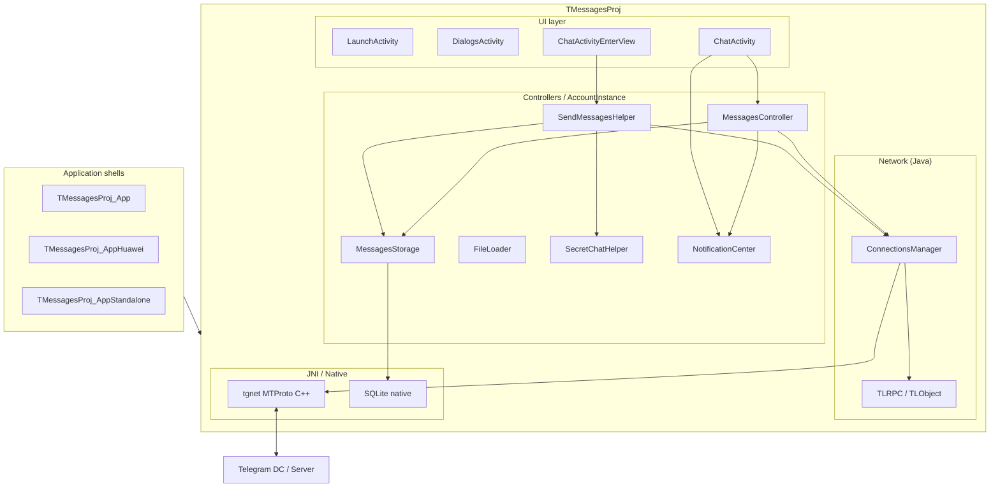
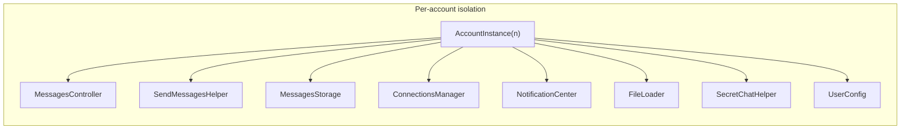
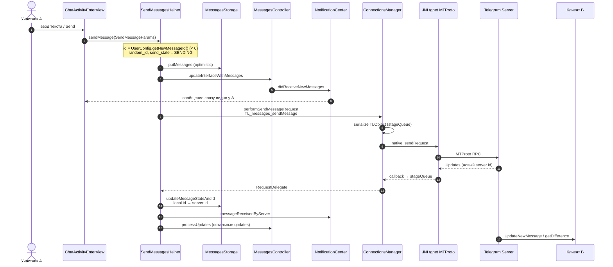
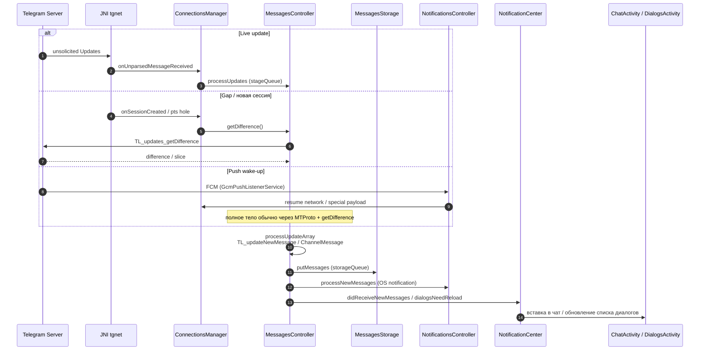
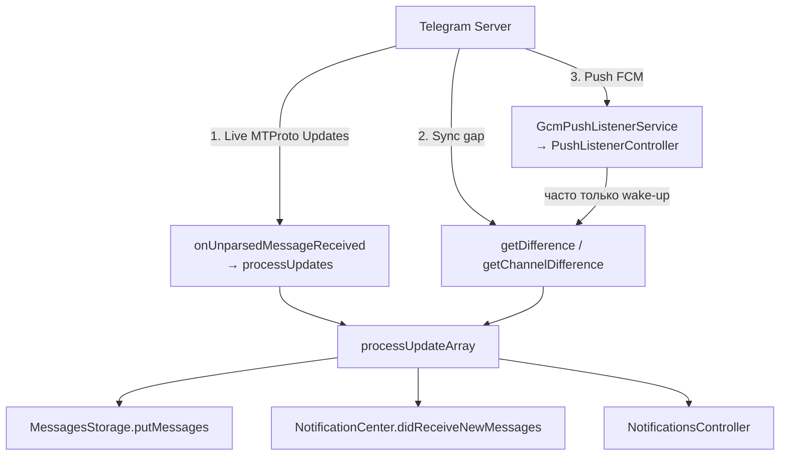
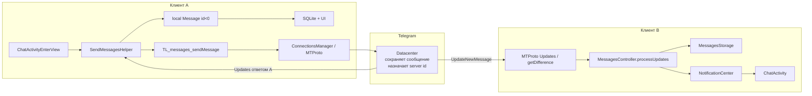
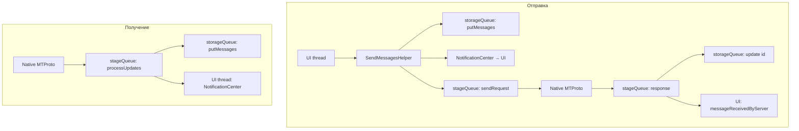

# Архитектура Telegram Android Client

Анализ официального исходного кода [Telegram App for Android](https://github.com/DrKLO/Telegram).  
Фокус: слои приложения и путь сообщения от участника A к участнику B.

---

## 1. Обзор проекта

Репозиторий — multi-module Gradle-проект. Ядро — библиотека `TMessagesProj`; тонкие app-модули собирают APK для разных каналов дистрибуции.

| Модуль | Назначение |
|--------|------------|
| `TMessagesProj` | Основная библиотека: UI, контроллеры, MTProto (Java + JNI), SQLite |
| `TMessagesProj_App` | Сборка для Google Play |
| `TMessagesProj_AppStandalone` | Standalone / вне Play |
| `TMessagesProj_AppHuawei` | Huawei / AGConnect |
| `TMessagesProj_AppHockeyApp` | Beta / HockeyApp |
| `TMessagesProj_AppTests` | Тесты и TL-tooling |
| `TMessagesProj_Modules/media` | AndroidX Media3 |
| `jlatexmath` | Рендер LaTeX |

### Пакеты внутри `TMessagesProj`

```
org.telegram/
├── ui/           — Activities, Fragments, Cells (ChatActivity, DialogsActivity, …)
├── messenger/    — бизнес-логика, storage, push, media
├── tgnet/        — Java-обёртка MTProto / TL (ConnectionsManager, TLRPC)
├── SQLite/       — Java-обёртки над native SQLite
└── jni/
    ├── tgnet/    — C++ MTProto (ConnectionsManager.cpp, Handshake, DC, …)
    ├── TgNetWrapper.cpp
    ├── sqlite/, voip/, ffmpeg/, …
```

---

## 2. Ключевые понятия

### AccountInstance / UserConfig

- **`AccountInstance`** — service locator на аккаунт (`MAX_ACCOUNT_COUNT`). Через него получают `MessagesController`, `MessagesStorage`, `ConnectionsManager`, `SendMessagesHelper`, `NotificationCenter`, `FileLoader`, `SecretChatHelper` и т.д.
- **`UserConfig`** — данные залогиненного пользователя. Для отправки критичен `getNewMessageId()`: выдаёт **отрицательный локальный id** (`lastSendMessageId`, старт с `-210000`) и декрементирует счётчик. Пока сервер не ответил, сообщение живёт с этим id.

### MessagesController

Центральный in-memory state machine (~25k строк): кэши users/chats, `dialogs_dict`, загрузка истории, **обработка updates**, `getDifference` / `getChannelDifference`, `updateInterfaceWithMessages`.  
Отдельного `UpdatesController` **нет** — вся синхронизация updates живёт здесь.

### SendMessagesHelper

Исходящий пайплайн: собирает локальный `TLRPC.Message`, optimistic insert в UI/DB, строит `TL_messages_sendMessage` / `TL_messages_sendMedia` (или encrypted), шлёт через `ConnectionsManager`, при ответе перемапливает local id → server id.

### MessagesStorage

Персистентность в SQLite. Собственная очередь **`storageQueue`**. Методы: `putMessages`, `updateMessageStateAndId`, хранение pts/date/qts для sync.

### ConnectionsManager / RequestDelegate

- Java: сериализация `TLObject` → `NativeByteBuffer` → `native_sendRequest`; десериализация ответа → `RequestDelegate.run(result, error)`.
- Native (`jni/tgnet`): сессии, DC, шифрование MTProto, long-poll / push updates.
- Входящие unsolicited updates: `onUnparsedMessageReceived` → `MessagesController.processUpdates`.

### TLRPC / TL / MTProto

- **`TLRPC.java`** — TL-типы (`Message`, `User`, `Chat`, `Peer`, `TL_messages_sendMessage`, `Updates`, …).
- **`TLObject`** — serialize/deserialize по 32-bit constructor id.
- **MTProto** — бинарный RPC поверх зашифрованных сессий к датацентрам Telegram (native).

### NotificationCenter

Per-account pub/sub. События — int-константы:

| Событие | Когда |
|---------|--------|
| `didReceiveNewMessages` | Новые сообщения (входящие или optimistic outgoing) |
| `messageReceivedByAck` | QuickAck от сервера (двойная галочка ещё не поставлена) |
| `messageReceivedByServer` / `…2` | Сервер принял, id обновлён |
| `messageSendError` | Ошибка отправки |
| `dialogsNeedReload` | Обновить список диалогов |

### Dialog / Chat / Peer / MessageObject

- **Dialog id** (`long`): user `> 0`, chat/channel `< 0`, secret chat — бит `0x4000000000000000`.
- **Peer / InputPeer** — TL-адресат (user / chat / channel).
- **MessageObject** — UI-обёртка над `TLRPC.Message` (`messageOwner`).  
  Состояния: `SENDING=1`, `SENT=0`, `SEND_ERROR=2`, `EDITING=3`. Pending → `id < 0`.

### Updates / getDifference

- Live: native → `onUnparsedMessageReceived` → `processUpdates`.
- Дыры в pts / новая сессия: `getDifference()` → `TL_updates_getDifference`.
- Каналы: `getChannelDifference`.
- `random_id` клиента ↔ `TL_updateMessageID` на сервере.

### FileLoader / media

Загрузка/выгрузка файлов. Для медиа: upload → затем `TL_messages_sendMedia`. `DelayedMessage` группирует альбомы и откладывает RPC до готовности файла.

### SecretChatHelper

Секретные чаты: `TL_decryptedMessage`, `performSendEncryptedRequest`, `decryptMessage`, `processUpdateEncryption`. На стороне A/B E2E-шифрование поверх обычного MTProto-канала к серверу.

### Очереди потоков

| Очередь | Роль |
|---------|------|
| **UI / Main** | Fragments, доставка `NotificationCenter` в UI |
| **`Utilities.stageQueue`** | `sendRequest`, `processUpdates`, difference, сетевая логика |
| **`MessagesStorage.storageQueue`** | Весь SQLite I/O |
| **Native MTProto threads** | Сокеты, таймеры → JNI callback |

---

## 3. Высокоуровневая архитектура





---

## 4. Путь сообщения: A → B (отправка)

Клиенты **не общаются напрямую**. A отправляет RPC на сервер Telegram; сервер доставляет update клиенту B.



### Шаги на стороне A (код)

1. **UI** — `ChatActivity` + `ChatActivityEnterView.sendMessage()` → `processSendingText()`  
   → `SendMessagesHelper.getInstance(account).sendMessage(params)`.

2. **Локальное сообщение** — `SendMessagesHelper.sendMessage`:
   - `id` / `local_id` = `UserConfig.getNewMessageId()` (отрицательный);
   - `random_id` = `getNextRandomId()`;
   - `send_state = MESSAGE_SEND_STATE_SENDING`.

3. **Optimistic UI/DB**:
   - `MessagesStorage.putMessages(...)`;
   - `MessagesController.updateInterfaceWithMessages` → `NotificationCenter.didReceiveNewMessages`.

4. **RPC**:
   - текст → `TLRPC.TL_messages_sendMessage`;
   - медиа → upload (`FileLoader`) → `TL_messages_sendMedia`;
   - secret → `TL_decryptedMessage` → `SecretChatHelper.performSendEncryptedRequest`.

5. **Сеть** — `performSendMessageRequest` → `ConnectionsManager.sendRequest` → `native_sendRequest` (MTProto).

6. **Ответ**:
   - QuickAck → `messageReceivedByAck`;
   - success (`Updates`) → remap id, `SENT`, `messageReceivedByServer`, `processUpdates`;
   - error → `messageSendError`.

### Ключевые файлы (send)

| Шаг | Файл |
|-----|------|
| Ввод | `ui/Components/ChatActivityEnterView.java` |
| Чат | `ui/ChatActivity.java` |
| Отправка | `messenger/SendMessagesHelper.java` |
| Локальные id | `messenger/UserConfig.java` |
| Storage | `messenger/MessagesStorage.java` |
| UI notify | `messenger/MessagesController.java` |
| События | `messenger/NotificationCenter.java` |
| RPC | `tgnet/ConnectionsManager.java` |
| TL-типы | `tgnet/TLRPC.java` |
| Native | `jni/TgNetWrapper.cpp`, `jni/tgnet/` |

---

## 5. Путь сообщения: получение у B



### Механизмы доставки updates



### Обработка в MessagesController

| Тип update | Поведение |
|------------|-----------|
| `TL_updates` / `TL_updatesCombined` | Сначала `TL_updateMessageID`, затем массив |
| `TL_updateShortMessage` / `ShortChatMessage` | Собрать `TL_message`, если pts непрерывен; иначе `getDifference` |
| `TL_updateNewMessage` / `NewChannelMessage` | В `processUpdateArray` → storage + UI |
| Encryption updates | `SecretChatHelper` |

### Ключевые файлы (receive)

| Шаг | Файл |
|-----|------|
| Native → Java | `tgnet/ConnectionsManager.java` |
| Updates | `messenger/MessagesController.java` |
| Secret decrypt | `messenger/SecretChatHelper.java` |
| Storage | `messenger/MessagesStorage.java` |
| Events | `messenger/NotificationCenter.java` |
| UI | `ui/ChatActivity.java`, `ui/DialogsActivity.java` |
| Push | `messenger/PushListenerController.java`, `GcmPushListenerService.java` |

---

## 6. End-to-end: текст от A к B



**Кратко:**

```
A: EnterView → SendMessagesHelper
 → Message(id < 0, SENDING) + SQLite + UI
 → TL_messages_sendMessage → MTProto → Server

Server: присваивает id, шлёт Updates A и B

A: remap id → SENT → messageReceivedByServer

B: onUnparsedMessageReceived / getDifference
 → processUpdates → SQLite → didReceiveNewMessages → UI
```

---

## 7. Модель потоков (send / receive)



---

## 8. Масштаб кода (ориентиры)

| Компонент | Порядок размера |
|-----------|-----------------|
| `TLRPC.java` | ~70k строк |
| `ChatActivity.java` | ~47k |
| `MessagesController.java` | ~25k |
| `SendMessagesHelper.java` | ~12k |

Архитектурный паттерн классический для Telegram Android: **per-account singletons**, **optimistic local messages**, **TL RPC поверх native MTProto**, **pts-based sync**, **NotificationCenter** как клей UI ↔ логика.

---

## 9. Ссылки на документацию Telegram

- [Telegram API](https://core.telegram.org/api)
- [MTProto](https://core.telegram.org/mtproto)
- [Obtaining api_id](https://core.telegram.org/api/obtaining_api_id)
- [Security guidelines](https://core.telegram.org/mtproto/security_guidelines)
